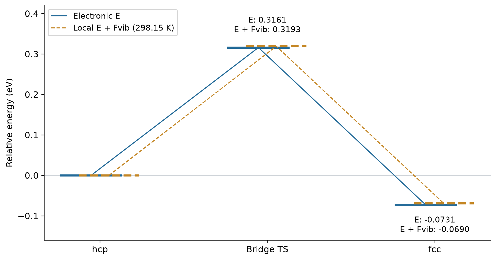

# Quantum5：Cu(111) 表面氧原子的迁移

周期性 GFN1-xTB 计算单个氧原子在 Cu(111) 相邻 hcp/fcc 空穴之间的迁移。四层4×4表面共64个Cu，吸附和迁移阶段固定Cu，只放松O。

**实验报告：10页、6幅图、4张表、7条编号引文，已逐页检查。** 仓库链接在正文末尾“数据与代码”节，封面不含链接。

- [在线阅读报告 PDF](experiment-report/oxygen_migration.pdf)
- [直接下载 PDF](https://github.com/populuscathayana/Quantum5/raw/refs/heads/main/experiment-report/oxygen_migration.pdf)
- [LaTeX 源文件](experiment-report/oxygen_migration.tex)
- [迁移动画](analysis/animations/oxygen-migration.gif) · [唯一虚频动画](analysis/animations/migration-mode.gif)
- [环境](ENVIRONMENT.md) · [后处理范围](POSTPROCESS.md) · [第三方说明](THIRD_PARTY_NOTICES.md)
- [48项离线科学复核](analysis/offline-verification.json) · [发布与页面检查](analysis/publication-audit.json)

相关实验：[Quantum1](https://github.com/populuscathayana/Quantum1) · [Quantum2](https://github.com/populuscathayana/Quantum2) · [Quantum3](https://github.com/populuscathayana/Quantum3) · [Quantum4](https://github.com/populuscathayana/Quantum4)

## 主要结果

| 物理量 | 电子能 / eV | 298.15 K局域振动自由能 / eV |
| --- | ---: | ---: |
| hcp → TS | 0.316053 | 0.319319 |
| fcc → TS | 0.389113 | 0.388310 |
| fcc − hcp | −0.073061 | −0.068991 |

两端各有3个实频，桥位峰顶的唯一虚频为 **187.2898i cm⁻¹**；其位移与路径切线的绝对余弦为0.99995。5图像CI-NEB在第7步达到全带收敛。fcc更稳定，氧经两空穴共用Cu原子间的桥位迁移。局域自由能只计固定铜骨架上O的稳定模式，不含铜声子或气相平动转动。



## 离线复核

```bash
git clone https://github.com/populuscathayana/Quantum5.git
cd Quantum5
python3 -m venv .venv
source .venv/bin/activate
python -m pip install -r requirements.txt
python reproduce.py
python reproduce.py --figures --animations
# 需要带ctex/Fandol的XeLaTeX
python reproduce.py --tex
```

后处理不连接服务器、不启动CP2K。每次输出到新建的 `reproduced/<时间>/`，不覆盖原始数据或发布版PDF。默认检查清单、全带收敛、Cu冻结、三个Hessian、迁移模式、同一能量基准和热修正；图形选项重建5张结果图及两段动画。理想模型示意图随报告保留，不由该选项重建。

## 内容与来源

| 目录 | 内容 |
| --- | --- |
| `experiment-report/` | PDF、TeX和6幅报告图 |
| `data/calculations/` | 裸表面、hcp/fcc优化与频率、CI-NEB及峰顶频率的输入/输出/坐标/小型Hessian；另保留原课件对称性基线和初始未收敛对照 |
| `data/structures/` | CI-NEB实际端点，保持输入相对路径可解析 |
| `data/manifest.json` | 来源相对路径、原始/公开文件校验值及脱敏说明 |
| `analysis/` | 科学核验、最终数据、CIF/XYZ/PDB及动画 |
| `scripts/`、`reproduce.py` | 可移植离线解析、绘图、热修正与报告编译 |

最终采用课件SCF阈值1e−6、OT-DIIS，无电子展宽；仅关闭空间群保持以严格固定指定Cu。初始额外收紧到1e−8的失败和保留空间群时底层移动的记录保持原状态，没有写成成功。科学结果不使用失败表面。

公开输出仅脱敏个人路径、启动用户名和机器名，不改变科学数值。历史审计的来源路径和哈希对应原始项目，可通过清单定位公开副本。课件全文、服务器连接配置、调度记录、密钥、大型波函数、软件安装包和临时下载均不上传。
